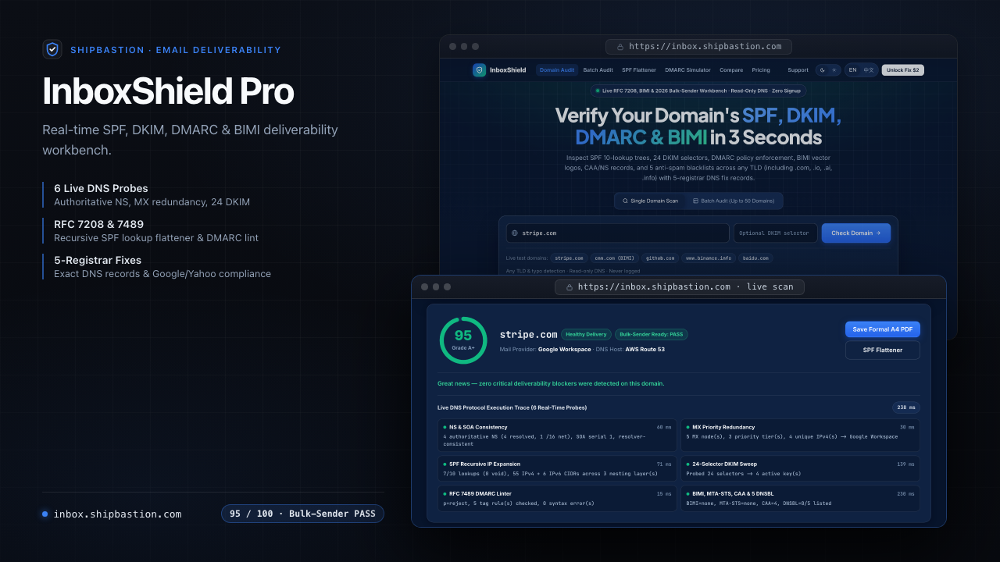

# InboxShield v7.0 — 6-Phase Email Deliverability, SPF Flattener & DMARC Linter (Web App + OSS CLI & GitHub Action)

**Audit Authoritative NS/SOA consistency, MX IPv4 redundancy, recursive SPF per-layer CIDR expansion (RFC 7208), 24 DKIM selectors, strict RFC 7489 DMARC tag syntax, MTA-STS, TLS-RPT, BIMI, and 5 DNSBL blacklists — directly in your browser with zero install, or locally in CI via `zColdWater/inboxshield-cli@v7`.**

[](./LICENSE)
[](https://nodejs.org)
[](./package.json)
[](https://inbox.shipbastion.com/?domain=stripe.com)
[](https://shipbastion.com/?url=https://zcoldwater.github.io/inboxshield-cli/)
[](https://cite.shipbastion.com/?url=https://zcoldwater.github.io/inboxshield-cli/)


<!-- shipbastion-hero:start -->
<p align="center">
  <a href="https://inbox.shipbastion.com/">
    
  </a>
</p>

*Live email DNS workbench at [inbox.shipbastion.com](https://inbox.shipbastion.com/) — instant SPF/DKIM/DMARC trace with zero signup.*
<!-- shipbastion-hero:end -->

- **Flagship v7.0 Online Web App (Zero Signup, 6-Phase Real Protocol Trace):** [https://inbox.shipbastion.com](https://inbox.shipbastion.com)
- **Free Online SPF Flattener (Collapse `>10`-Lookup PermError -> `1/10`):** [https://inbox.shipbastion.com/spf-flattener](https://inbox.shipbastion.com/spf-flattener)
- **Free Interactive DNS Builders (Zero Signup):** [MTA-STS, TLS-RPT & BIMI SVG Tiny-PS Generator](https://zcoldwater.github.io/inboxshield-cli/mta-sts-tls-rpt-bimi-generator.html) · [DMARC p=reject & 3-Stage Rollout Planner](https://zcoldwater.github.io/inboxshield-cli/dmarc-p-reject-rua-policy-generator.html) · [Google/Yahoo 2026 Bulk Sender Checklist](https://zcoldwater.github.io/inboxshield-cli/google-yahoo-2026-bulk-sender-compliance-checklist.html) · [SPF Record & 10-Lookup Calculator](https://zcoldwater.github.io/inboxshield-cli/spf-record-generator.html)
- **NEW — 2026 Top 60 SaaS & AI Startups Email Authentication, SPF Bloat & DMARC Spoofing Benchmark:** [Interactive 60-Brand Leaderboard](https://zcoldwater.github.io/inboxshield-cli/top-60-saas-email-authentication-benchmark-2026.html) · [Raw JSON Dataset](https://zcoldwater.github.io/inboxshield-cli/top-60-saas-email-authentication-benchmark-2026.json)
- **2026 Indie SaaS Email Deliverability Benchmark (60 GitHub Startup Domains):** [Interactive HTML Study](https://zcoldwater.github.io/inboxshield-cli/email-deliverability-benchmark-2026.html) · [Markdown](./docs/email-deliverability-benchmark-2026.md)
- **40 Zero-Dependency AI Agent Skills (`skills.sh` — SPF/DKIM/DMARC, Cold Email, Google Workspace, M365, SES, Security & GEO):** `npx skills add zColdWater/omniforge-skills` ([Browse All 40 Skills](https://zcoldwater.github.io/omniforge-skills/))
- **EasyDMARC ($432/yr) vs. InboxShield ($2 Launch Special) Comparison:** [https://zcoldwater.github.io/launch-audit-reports/compare/easydmarc-vs-inboxshield.html](https://zcoldwater.github.io/launch-audit-reports/compare/easydmarc-vs-inboxshield.html)
- **Single-Domain Emergency Fix ($2 Launch Special, reg. $9 — One-Time — Instant In-Browser Unlock, 14-Day Refund):** [Gumroad Checkout](https://api.shipbastion.com/go/gumroad/inboxshield) · [Direct Checkout](https://api.shipbastion.com/checkout/inboxshield)
- **OmniForge Complete Suite ($5 Launch Special, reg. $29 — One-Time — Unlocks VibeShield + InboxShield + CiteReady):** [Gumroad Bundle](https://api.shipbastion.com/go/gumroad/launch-stack) · [Direct Checkout](https://api.shipbastion.com/checkout/launch-stack)

---

## 2026 Indie SaaS Passive DNS Benchmark Highlights (N = 60 Custom Domains)

In our passive DNS audit of **60 recently active GitHub indie SaaS & AI custom domains** ([full report](./docs/email-deliverability-benchmark-2026.md)):
- **71.7% (43/60)** have **no enforced DMARC policy** (`35.0%` missing `_dmarc` entirely; `36.7%` stuck on monitor-only `p=none`).
- **33.3% (20/60)** ship with **no SPF record**, and **45.0% (27/60)** lack an active DKIM selector across 24 standard ESP selectors.
- **Average Deliverability Score:** **60.3 / 100** (`53.3%` score under `70/100`), with **100%** missing MTA-STS & TLS-RPT.

---

## What InboxShield v7.0 Audits (6 Real Protocol Phases)

1. **Authoritative NS Consistency & SOA Verification:** Native vs. Cloudflare DoH `NS` cross-check, glue IPv4 resolution, `/16` subnet diversity, and SOA primary-in-NS check.
2. **MX Multi-Node Priority Redundancy & ESP Auto-Detection:** Resolves per-MX IPv4s, detects single-IP false redundancy & RFC 7505 Null MX, and auto-detects Google Workspace, Microsoft 365, Cloudflare Email Routing, Resend, Zoho, Tencent Exmail, Aliyun, and Feishu/Lark.
3. **SPF Nested Per-Layer IP/CIDR Expansion (RFC 7208):** Counts recursive DNS lookups (`>10` = `PermError`), void lookups (`>2`), exact `ip4`/`ip6` CIDR expansion per layer (`L0/L1/L2`), and duplicate conflicting `v=spf1` records.
4. **24-Selector DKIM Public Key Audit:** Probes 24 standard ESP DKIM selectors and checks RSA key length.
5. **Strict RFC 7489 DMARC Tag Syntax Linter:** Validates exact-case `v=DMARC1`, duplicate `_dmarc` conflicts, tag allowlist (`v`, `p`, `sp`, `pct`, `adkim`, `aspf`, `rua`, `fo`, `ri`), and enforcement posture.
6. **MTA-STS, TLS-RPT, BIMI & 5 DNSBL Blacklists:** Verifies transport encryption policies, brand logo SVG readiness, and IP blacklist health.

---

## Free Online Web App vs. Single-Domain Emergency Fix (`$2` Launch Special, `~~$9~~` One-Time)

| Capability | Free Online Scanner & OSS CLI | Single-Domain Emergency Fix ($2 Launch, ~~$9~~) | OmniForge Complete Suite ($5 Launch, ~~$29~~) |
| :--- | :---: | :---: | :---: |
| **6-Phase Deep DNS Protocol Diagnostics** | Unlimited 1-by-1 | **Included + 50-Domain Batch CSV** | **All Web Suites Unlocked** |
| **Online SPF Flattener (RFC 7208)** | Free online | **Auto-Merged & Flattened 1-TXT Output** | **InboxShield v7.0 ($2 Launch)** |
| **5 Copy-Paste DNS Fix Records** | Root-cause diagnosis | **Unmasked SPF, DMARC, DKIM, MTA-STS & TLS-RPT for Cloudflare, GoDaddy, Namecheap, Aliyun & DNSPod** | **+ VibeShield v7.0 ($2 Launch)** |
| **Printable A4 Client Deliverability PDF** | Summary only | **Branded A4 PDF Export (`@media print`)** | **+ CiteReady v6.0 ($2 Launch)** |
| **Companion Free Domain Tool** | [BrandShield v6.2 (100% Free)](https://brand.shipbastion.com) | **78 TLDs + 17 Aftermarket Marketplaces Free** | **Included Free Forever** |

> **Honest Scope:** InboxShield is an on-demand live DNS diagnostic & copy-paste remediation workbench (`$2` Launch Special, reg. `$9`, vs. `$432+/yr` hosted DMARC SaaS platforms). It does not operate a hosted 24/7 inbound DMARC XML mailbox server (no CNAME lock-in, no subscriptions).

---

## Quick Start (`npx` — Zero Install, Runs Locally)

```bash
# Audit any sending domain locally (Node.js 20+, zero dependencies)
npx github:zColdWater/inboxshield-cli check stripe.com
npx github:zColdWater/inboxshield-cli check github.com --json
```

```yaml
name: Email Deliverability Gate
on:
  schedule:
    - cron: "0 8 * * *"
  workflow_dispatch:

jobs:
  audit:
    runs-on: ubuntu-latest
    steps:
      - uses: actions/setup-node@v4
        with:
          node-version: "22"
      - uses: zColdWater/inboxshield-cli@v7
        with:
          domain: yourdomain.com
          min-score: "80"
          fail-on-spf-permerror: "true"
```

## Live Badge Embed

```markdown
[](https://inbox.shipbastion.com/?domain=yourdomain.com)
```

## Support & Contact

OmniForge · Agent Arena Studio — `agentarenastudio@proton.me` · [@agentarenastudi](https://x.com/agentarenastudi) · [Support Portal](https://api.shipbastion.com/support) · [14-Day Refund Policy](https://api.shipbastion.com/refund-policy)

## License

MIT (c) OmniForge · Agent Arena Studio
